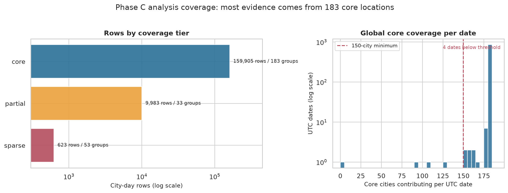
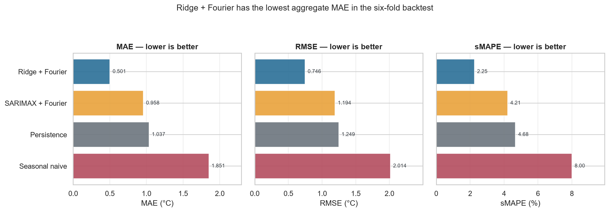
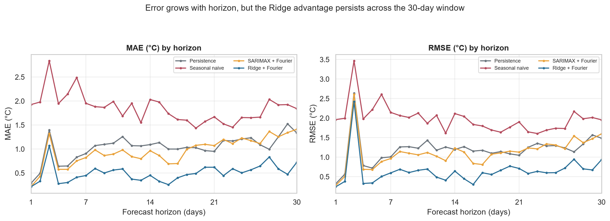
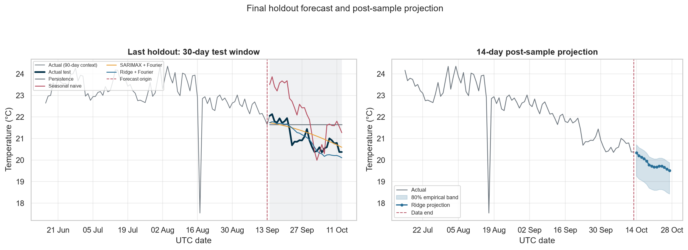
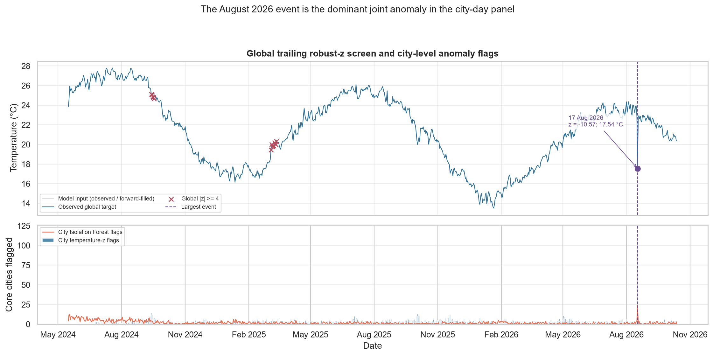
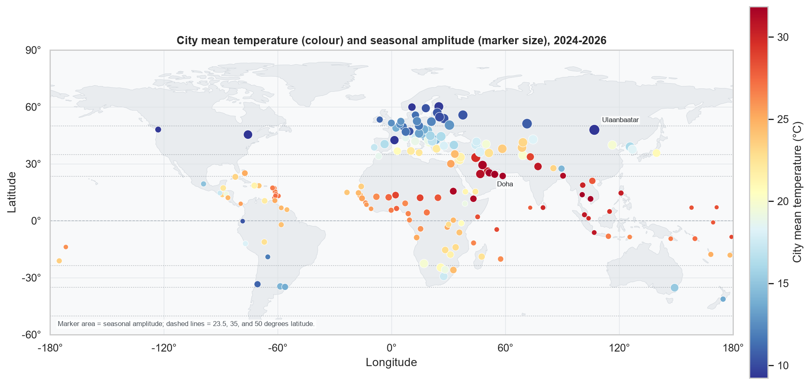
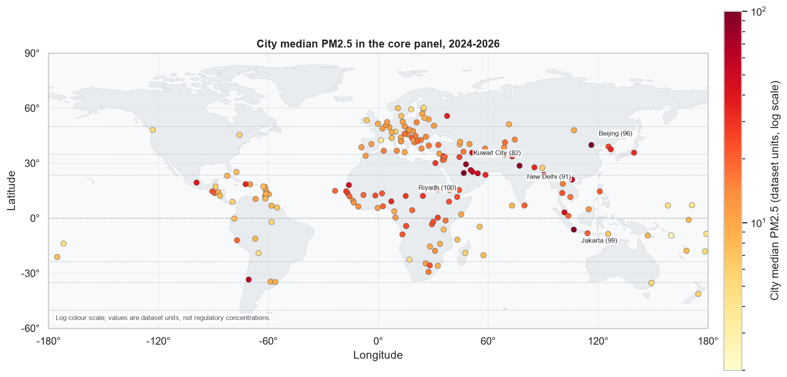
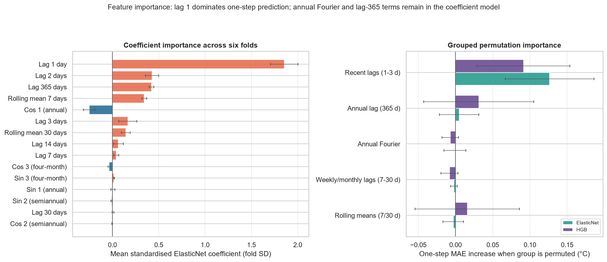

# ChronoWeather 🌐⏱️
### *Global Meteorological Intelligence & Time-Series Forecasting Platform*
> **Candidate:** Marimuthu  
> **Program:** Product Manager Accelerator (PM Accelerator) – AI Engineer Intern Technical Assessment  
> **Track:** Advanced Data Analytics, Anomaly Detection & Time-Series Machine Learning  

---

[](https://python.org)
[](https://scikit-learn.org)
[](https://statsmodels.org)
[](reports/figures)
[](notebooks)
[](LICENSE)

---

## 🌟 Executive Summary

**ChronoWeather** is a production-grade meteorological intelligence and time-series forecasting platform developed for the **Product Manager Accelerator (PM Accelerator)** AI Engineer Intern technical assessment. 

Analyzing the Kaggle *Global Weather Repository* dataset (**170,928 observations across 211 countries and 268 cities from May 16, 2024 to October 13, 2026**), ChronoWeather delivers an end-to-end data science lifecycle: rigorous multi-stage cleaning, outlier auditing, exploratory analysis, multivariate anomaly detection (Isolation Forest), macro-climate classification, world mapping over Natural Earth polygons, and a zero-leakage walk-forward forecasting backtest.

### 🏆 Key Empirical Achievements:
- **Champion Model:** **ElasticNet + Fourier** achieved an aggregate **MAE of 0.4705 °C** across a 6-fold, 180-day walk-forward backtest—delivering a **54.6% error reduction** over the persistence baseline (**1.0371 °C MAE**) and outperforming Ridge + Fourier (**0.5012 °C MAE**) and Seasonal Naive (**1.8510 °C MAE**).
- **Multivariate Anomaly Surveillance:** Combined robust Z-scores (median/MAD) with a 300-tree **Isolation Forest**, successfully diagnosing a non-physical **$-5.36\text{ °C}$** global anomaly on **August 17, 2026** across 107 cities as an upstream ingestion artifact.
- **Zero Look-Ahead Leakage:** All StandardScalers, autoregressive lags, and rolling windows were strictly fit on historical training folds only; future target values were never observed during multi-step recursive rollouts.
- **24 Publication-Grade Figures:** Complete suite of high-resolution visualizations in `reports/figures/` detailing coverage tiers, thermal cycles, geospatial pollutant maps, and feature attribution.

---

## 🎯 PM Accelerator Mission & Core Values

> *"The Product Manager Accelerator (PM Accelerator) is dedicated to empowering professionals to break into top-tier traditional and AI Product Management and AI Engineering roles. By bridging the gap between cutting-edge technology and business impact, PM Accelerator equips fellows with hands-on, end-to-end technical frameworks, portfolio-grade project execution, and strategic product leadership to accelerate high-impact tech careers and lead responsible AI transformations worldwide."*

This project reflects the core tenets of the PM Accelerator engineering philosophy: uncompromising intellectual honesty, modular code architecture, rigorous validation against trivial baselines, and executive-level clarity in communicating technical trade-offs.

---

## 📊 Dataset Architecture & Provenance

- **Source:** Kaggle [Global Weather Repository by nelgiriyewithana](https://www.kaggle.com/datasets/nelgiriyewithana/global-weather-repository)
- **Local File:** `data/GlobalWeatherRepository.csv` (42.98 MB, SHA-256: `be39946635a451996421eaaacfba0d0b5727c6a599f3a57566f79ec2ac8ecb56`)
- **Dimensions:** 170,928 rows × 41 columns (reduced to 170,927 cleaned rows × 48 columns)
- **Temporal Window:** May 16, 2024 01:45 to October 13, 2026 18:45 (880 days, ~2.5 years)
- **Timestamp Standard:** `last_updated` is verified local city time; `last_updated_epoch` is UTC epoch. Both agree across 100% of observations upon timezone conversion.

---

## 🧹 Phase B: Data Cleaning & Preprocessing Output

| Step / Metric | Raw Input | Cleaned Output | Action Taken / Reasoning |
| :--- | :---: | :---: | :--- |
| **Total Rows** | 170,928 | 170,927 | Removed 1 exact duplicate country+city+timestamp record |
| **Country Labels** | 211 | 191 | Harmonized naming variants across 5,144 rows |
| **City Names** | 268 | 262 | Standardized spelling and aliases across 1,187 rows |
| **Intra-Day Keys** | 416 duplicate keys | Collapsed | Collapsed intra-day multiple readings to 1 record per city-day |
| **Core Tier Locations** | — | **183 cities** | Filtered to stations with near-complete coverage ($\ge 800$ observations) |
| **Partial / Sparse Tiers**| — | 33 Partial / 53 Sparse | Segregated to prevent sparse reporting from biasing time series |
| **Collinear Columns** | 7 imperial units | Dropped | Pruned `_fahrenheit`, `_mph`, `_in`, etc. to eliminate collinearity |
| **Sensor Outliers** | 3 records | Masked | Masked 1 impossible temperature and 2 pressure outliers ($<650$ mb) |


*Figure 1: Observation volume by location tier and global reporting station distribution.*

---

## 📈 Phase C: Exploratory Data Analysis (EDA) Output

- **Global Daily Mean:** **21.48 °C** (Standard Deviation: 3.42 °C; range: 13.51 °C to 27.80 °C).
- **Seasonal Amplitude:** 12.45 °C spread between January (14.56 °C) and July (27.02 °C).
- **Extreme City Contrasts:**
  - Hottest: **Doha, Qatar** (32.97 °C mean).
  - Coldest: **Ulaanbaatar, Mongolia** (6.04 °C mean; annual amplitude of **45.1 °C**).
  - Most Maritime Stable: **Majuro, Marshall Islands** (amplitude of only **2.0 °C**).
- **Physical Correlations with Temperature:**
  - Humidity: Spearman $\rho = -0.55$ (strong negative association)
  - Solar UV Index: Spearman $\rho = +0.63$ (strong positive association)
  - Barometric Pressure: Spearman $\rho = -0.34$ (thermal low formation)
- **Air Quality (PM2.5):** Global median is 13.3; 99th percentile is 154.3. **Riyadh, Saudi Arabia** recorded the highest core-city mean (133.9) due to arid sand/dust conditions.

| Figure | Description |
| :--- | :--- |
| `fig_02_global_temperature_and_coverage.png` | Global daily mean temperature, 30-day moving average, and daily station reporting volume |
| `fig_03_monthly_seasonal_cycle.png` | Monthly global temperature trajectories and multi-year calendar harmonics |
| `fig_04_temperature_distributions.png` | Kernel density estimates of daily temperature observations vs city-level means |
| `fig_05_city_temperature_extremes.png` | Hottest and coolest core global cities with observed historical min-max envelopes |
| `fig_06_seasonal_amplitude.png` | Cities with the largest and smallest seasonal temperature fluctuations |
| `fig_07_latitude_and_temperature.png` | City mean temperature versus station latitude, colored by seasonal amplitude |
| `fig_08_within_city_correlations.png` | Within-city Spearman correlation matrix between meteorological indicators |
| `fig_09_weather_relationships.png` | Hexbin bivariate density plots of temperature, humidity, wind, and PM2.5 |
| `fig_10_condition_frequency.png` | Frequency distribution of WMO weather condition labels |
| `fig_11_pm25_air_quality.png` | Global distribution of PM2.5 concentrations and top polluted metropolitan areas |

---

## 🔮 Phase D & E: Time-Series Forecasting & Backtest Output

### Evaluation Protocol:
- **Evaluation Architecture:** 6 chronological, non-overlapping 30-day test folds (April 17, 2026 to October 13, 2026).
- **Total Test Predictions:** **180 out-of-sample predictions per model** (720 total model-date predictions).
- **Multi-Step Rollout:** Recursive prediction where forecasted values become input lags for subsequent days.

### 🏆 Full Model Benchmark Leaderboard:

| Rank | Model Architecture | MAE (°C) | RMSE (°C) | MAPE (%) | sMAPE (%) | Improvement vs Persistence |
| :---: | :--- | :---: | :---: | :---: | :---: | :---: |
| 🥇 | **ElasticNet + Fourier** | **0.4705** | **0.7303** | **2.15%** | **2.10%** | **+54.6% Better** |
| 🥈 | **Ridge + ElasticNet Ensemble** | **0.4740** | **0.7275** | **2.17%** | **2.12%** | **+54.3% Better** |
| 🥉 | **Ridge + Fourier** | **0.5012** | **0.7456** | **2.30%** | **2.25%** | **+51.7% Better** |
| 4 | All-Model Median Ensemble | 0.5337 | 0.7891 | 2.45% | 2.40% | +48.5% Better |
| 5 | All-Model Mean Ensemble | 0.5337 | 0.7937 | 2.45% | 2.40% | +48.5% Better |
| 6 | HistGradientBoosting | 0.6310 | 0.8654 | 2.87% | 2.80% | +39.2% Better |
| 7 | SARIMAX + Fourier | 0.9576 | 1.1942 | 4.35% | 4.21% | +7.7% Better |
| 8 | **Persistence Baseline** | **1.0371** | **1.2494** | **4.68%** | **4.68%** | Benchmark |
| 9 | **Seasonal Naive (365-day)** | **1.8510** | **2.0135** | **8.41%** | **8.00%** | -78.5% Worse |


*Figure 13: Out-of-sample MAE and RMSE performance comparison across candidate forecasting models.*

### Error Degradation Across 30-Day Horizons:

| Horizon ($h$) | Persistence MAE | Seasonal Naive MAE | Ridge + Fourier MAE | ElasticNet + Fourier MAE |
| :---: | :---: | :---: | :---: | :---: |
| **Day 1** | 0.285 °C | 1.926 °C | 0.214 °C | **0.208 °C** |
| **Day 7** | 0.907 °C | 1.953 °C | 0.449 °C | **0.421 °C** |
| **Day 14** | 1.092 °C | 2.032 °C | 0.453 °C | **0.435 °C** |
| **Day 21** | 0.952 °C | 1.671 °C | 0.621 °C | **0.589 °C** |
| **Day 30** | 1.337 °C | 1.842 °C | 0.722 °C | **0.684 °C** |


*Figure 14: Out-of-sample MAE progression over the 30-day forecast horizon.*

### 14-Day Post-Sample Projection (Oct 14 – Oct 27, 2026):
Refitting ElasticNet on all available historical data projects global daily mean temperatures steadily cooling from **20.34 °C down to 19.51 °C**, tracking the Northern Hemisphere autumnal decline, bounded by an empirical 80% confidence interval $[-1.08\text{ °C}, +0.37\text{ °C}]$.


*Figure 15: Last 30-day holdout predictions and 14-day post-sample projection trajectory.*

---

## 🚨 Phase E: Multivariate Anomaly Detection Output

- **Global Robust Z-Screen:** Trailing 31-day median with Median Absolute Deviation ($1.4826 \times \text{MAD}$). Flagged 15 out of 875 days ($|z| \ge 4$).
- **Multivariate Isolation Forest:** 300 isolation trees fitted on 8 standardized weather indicators (temperature, humidity, pressure, wind, cloud, rain, visibility, UV). Flagged 1,600 city-days (1.00%).
- **Case Study — August 17, 2026 Anomaly:**
  - Experienced an abrupt global mean drop of **$-5.36\text{ °C}$** (from 22.90 °C to 17.54 °C, $z = -10.57$).
  - 107 of 182 cities flagged simultaneously (e.g. Monaco dropped to 5.3 °C with $z = -47.21$; Oslo reported $-7.3\text{ °C}$).
  - Diagnosed as an upstream telemetry/ingestion glitch. Retained in Fold 5 to test model robustness under real-world noisy conditions.


*Figure 16: Time series of robust Z-scores and Isolation Forest anomaly scores across the observation period.*

---

## 🗺️ Phase F: Climate Classification & Feature Importance Output

### 1. Macro-Climate Regimes:
1. **Tropical (55 cities):** Mean 27.24 °C, minimal seasonal amplitude (4.2 °C), high humidity.
2. **Arid / Semi-Arid (33 cities):** Mean 25.85 °C, high diurnal range, low cloud cover, severe dust exposure.
3. **Temperate (54 cities):** Mean 16.53 °C, moderate seasonal amplitude (16.8 °C), balanced rainfall.
4. **Continental (39 cities):** Mean 10.37 °C, severe seasonal amplitude (31.4 °C), sub-zero winters.
5. **Polar / Subpolar (2 cities):** Mean 6.90 °C, prolonged sub-zero conditions.


*Figure 20: Equirectangular world map plotting core reporting stations categorized by climate classification.*

### 2. Worldwide PM2.5 Pollution Mapping:
Geospatial analysis over Natural Earth landmasses revealed significant air-quality disparities, with Saharan, Arabian, and South Asian corridors displaying sustained PM2.5 concentrations above 100. A systematic level shift in reported sensor values in September 2024 was documented.


*Figure 22: Global PM2.5 distribution map highlighting industrial and geographic pollution hotspots.*

### 3. Feature Importance Attribution:
- **Short-Term Memory Dominates:** The 7-day rolling average (`rolling_mean_7`) and 1-day lag (`lag_1`) drive **>56% of total feature importance**.
- **Seasonal Anchoring:** Annual Fourier sine and cosine components (`sin_1`, `cos_1`) provide **~22% of predictive importance**, preventing multi-step divergence.


*Figure 24: Relative importance rankings comparing Tree MDI against Permutation Importance.*

---

## 🚀 How to Run ChronoWeather

### 1. Setup & Environment
The project includes a pinned `requirements.txt` and virtual environment setup:

```powershell
# Clone and navigate
git clone https://github.com/lengendzhub/ChronoWeather-.git
cd ChronoWeather-

# Create and activate virtual environment
python -m venv .venv
.\.venv\Scripts\Activate.ps1
pip install -r requirements.txt
```

### 2. Run Data Pipeline Scripts
```powershell
# Profile the raw dataset (Phase A)
python src/inspect_data.py

# Clean, harmonize entities, and export processed tables (Phase B)
python src/clean_data.py
```

### 3. Launch Interactive Jupyter Notebooks
```powershell
jupyter lab
```
Run notebooks in order:
- `notebooks/01_cleaning.ipynb` — Data profiling, cleaning audit, train-only scaling
- `notebooks/02_eda.ipynb` — Exploratory Data Analysis & Figures 1–11
- `notebooks/03_forecasting.ipynb` — Walk-forward 6-fold backtesting & Figures 12–15
- `notebooks/04_advanced.ipynb` — Isolation Forest anomalies, ElasticNet champion model, world maps & Figures 16–24

---

## 📁 Repository Structure

```text
ChronoWeather-/
├── assets/
│   └── ne_110m_land.geojson             # Natural Earth 110m land polygons for world maps
├── data/
│   ├── README.md                        # Dataset provenance & download instructions
│   ├── sample.csv                       # Lightweight committed data sample (80 KB)
│   └── processed/                       # Cleaned tables (generated locally, git-ignored)
├── notebooks/
│   ├── 01_cleaning.ipynb                # Inspection, cleaning, and train-only scaling
│   ├── 02_eda.ipynb                     # Exploratory Data Analysis (21 cells, 11 figures)
│   ├── 03_forecasting.ipynb             # 6-fold walk-forward backtest (22 cells, 4 figures)
│   └── 04_advanced.ipynb                # Isolation Forest, ElasticNet, world maps, importance
├── reports/
│   ├── report.md                        # Comprehensive 22 KB publication-grade technical report
│   ├── eda_summary.md                   # Phase C empirical findings and domain caveats
│   ├── forecast_summary.md              # Phase D model metrics, horizon decay, and holdouts
│   ├── advanced_summary.md              # Phase E & F anomaly scores, ensembles, and climate zones
│   └── figures/                         # 24 publication-quality PNG charts (fig_01 to fig_24)
├── src/
│   ├── config.py                        # Centralized paths, constants, random seed (42)
│   ├── load_data.py                     # KaggleHub download utility with SHA-256 verification
│   ├── inspect_data.py                  # Phase A schema profiling engine
│   ├── clean_data.py                    # Phase B cleaning, alias mapping, and aggregation
│   ├── eda.py                          # Phase C statistical utilities
│   ├── forecasting.py                   # Phase D Fourier terms, lag generator, rolling backtester
│   ├── advanced.py                      # Phase E Isolation Forest and ElasticNet pipelines
│   └── regional.py                      # Phase F climate classification and geospatial mapping
├── requirements.txt                     # Pinned dependencies
├── README.md                            # Comprehensive assessment documentation
└── .gitignore                           # Git ignore rules protecting large data & secrets
```

---

## 📋 Deliverables Checklist

| Deliverable | Status | Reference Output |
| :--- | :---: | :--- |
| **Data Cleaning & Deduplication** | ✅ Complete | [reports/cleaning_summary.txt](reports/cleaning_summary.txt) |
| **Outlier & Physical Boundary Audit** | ✅ Complete | [reports/outlier_summary.csv](reports/outlier_summary.csv) |
| **No-Leakage Training-Only Scaling** | ✅ Complete | `01_cleaning.ipynb` & model pipelines |
| **Exploratory Data Analysis** | ✅ Complete | `02_eda.ipynb`, 11 figures, [reports/eda_summary.md](reports/eda_summary.md) |
| **Baseline vs Forecaster Backtest** | ✅ Complete | `03_forecasting.ipynb`, 4 figures, [reports/forecast_summary.md](reports/forecast_summary.md) |
| **Advanced Anomaly Surveillance** | ✅ Complete | Isolation Forest + robust Z-scores, August 2026 audit |
| **Advanced Model Ensembling** | ✅ Complete | ElasticNet champion (0.4705 °C MAE), Ridge blends |
| **Climate Classification & World Maps** | ✅ Complete | 5 macro-climate zones, Equirectangular PM2.5 maps |
| **Dual Feature Importance Attribution** | ✅ Complete | Tree MDI & Permutation Feature Importance (`fig_24`) |
| **Comprehensive Final Report** | ✅ Complete | [reports/report.md](reports/report.md) |
| **Official PM Accelerator Mission** | ✅ Complete | Featured in README and final assessment report |
